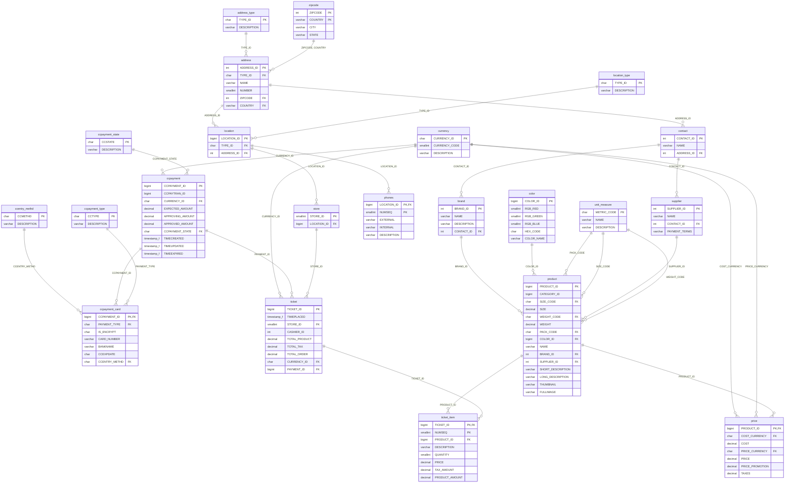
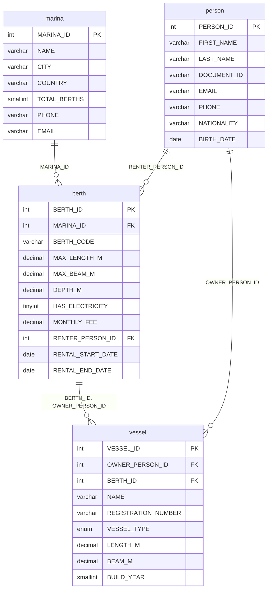

# Relational Data Models (MySQL)

**Two operational database designs built in MySQL Workbench: a 22-table grocery point-of-sale system and a 4-table marina berth-rental system.**

Each model ships as the original `.mwb` file, forward-engineered MySQL DDL and an ER diagram that renders on GitHub.

| Model | Tables | Foreign keys | Focus |
|---|---|---|---|
| [Grocery POS](#1-grocery-point-of-sale) | 22 | 28 | Normalised master data, tickets, card payments, multi-currency pricing |
| [Marina](#2-marina-berth-rental) | 4 | 4 | Business rules enforced by the schema itself |

## 1. Grocery point of sale

Covers the full path from a product on the shelf to a paid ticket: products with brand, supplier, colour and unit measures; stores and locations with typed addresses; tickets and ticket lines; card payments with state, type and entry method; prices with cost, promotion and tax in separate currencies.

Design choices:
- **Lookup tables for every code** (address type, location type, card state, card type, entry method, currency, unit measure) so codes are validated, not free text.
- **Composite keys where the business has them:** `zipcode (ZIPCODE, COUNTRY)` because postcodes repeat across countries; `ticket_item (TICKET_ID, NUMSEQ)` and `phones (LOCATION_ID, NUMSEQ)` for ordered child rows.
- **Ticket totals stored on the header** (product, tax, order) for fast reporting, with line-level amounts kept for audit.



## 2. Marina berth rental

A marina rents berths to people; people own vessels; a vessel can be docked at a berth.

The rule that makes this model interesting: **a vessel can only be docked at a berth rented by its own owner.** It is enforced with a composite foreign key, not application code:

```sql
UNIQUE KEY uq_berth_renter (BERTH_ID, RENTER_PERSON_ID)            -- on berth
FOREIGN KEY (BERTH_ID, OWNER_PERSON_ID)
  REFERENCES berth (BERTH_ID, RENTER_PERSON_ID)                     -- on vessel
```

Other constraints: berth codes are unique per marina, not globally; registration numbers, document IDs and emails are unique; vessel type is an `ENUM`; a vessel with no berth (`BERTH_ID` NULL) sits on the waiting list.



`sql/marina_seed.sql` loads sample data (fictional people) and `sql/marina_queries.sql` answers occupancy, monthly income and waiting-list questions. Trying to dock a vessel at someone else's berth fails with a foreign key error, as designed.

## Files

```
models/       original MySQL Workbench files (.mwb)
sql/          DDL per model, seed data and example queries for the marina
tools/        mwb_to_sql.py: reads a .mwb file and writes the DDL and Mermaid diagram
```

Regenerate the DDL and diagrams:

```bash
python3 tools/mwb_to_sql.py models/marina_db.mwb sql/marina_db.sql marina_db.mmd
```

---
SQL Based Data Architectures II, Master in Business Analytics and Data Science, IE School of Science & Technology, November 2026.

Tools: MySQL Workbench · MySQL · Python
